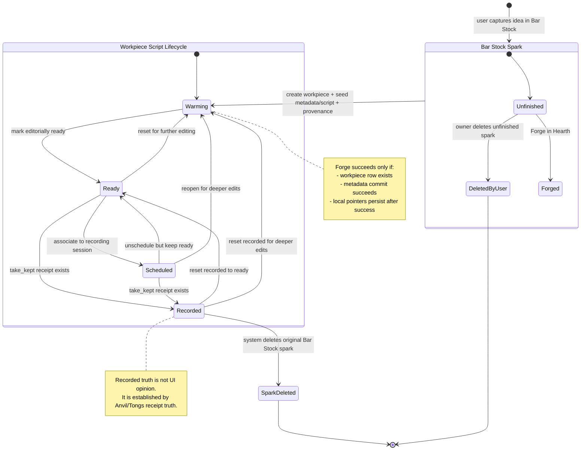
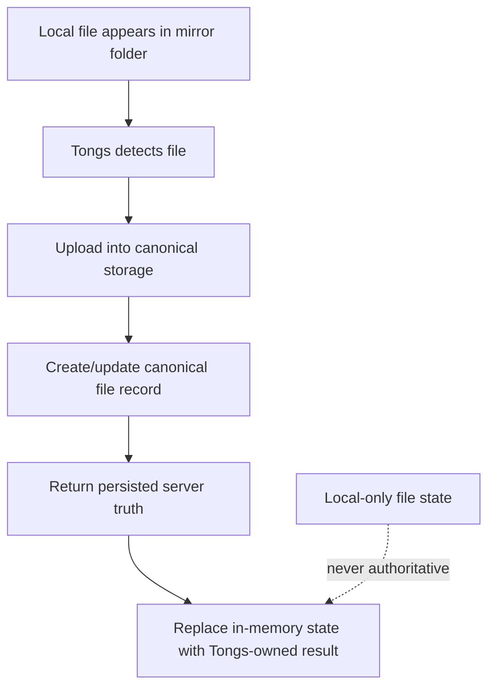
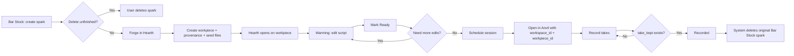

# Forge Lifecycle State Machine Diagram

Companion reference only. Constitutional lifecycle semantics are defined in `FORGE_SPARK_TO_ANVIL_LIFECYCLE_CANON.md`.

This document turns the lifecycle canon into operational diagrams and policy guidance without replacing the canon.

Deletion implementation planning lives separately in `WORKPIECE_DELETION_POLICY_PLAN.md` so this document can stay operational instead of procedural.

## State And Authority Table

| State | Meaning | Authority | Canonical Persistence | Allowed Transitions | Auto Cleanup | User Delete? | Notes |
| --- | --- | --- | --- | --- | --- | --- | --- |
| `spark_unfinished` | Bar-Stock intake object that has not yet completed forge/record lifecycle | Bar-Stock for capture and owner intent; Tongs for persisted record if stored canonically | Spark record and provenance links in Tongs-backed paths | `spark_unfinished -> workpiece_warming`, `spark_unfinished -> spark_deleted` | None | Yes | Spark is persistent while useful, but not a forever artifact |
| `spark_deleted` | Spark removed by the owner before completion or by the system after successful completion | Bar-Stock cleanup rules and system lifecycle cleanup | Canonical delete or tombstone policy in Tongs-backed spark storage | Terminal | System may auto-delete after `recorded` | Yes | Spark deletion must never destroy the superseding workpiece |
| `workpiece_warming` | Active editorial shaping in Hearth | Hearth for editorial actions; Tongs for persisted truth | Workpiece row, package files, metadata, revisions, and derived artifacts in Tongs | `warming -> ready`, `warming -> recorded` only through kept-take truth after prior readiness path, reversible from higher states | None | Not as a lifecycle action; archive/delete is separate policy | Durable production container and cross-tool identity |
| `workpiece_ready` | Editorially ready for scheduling or recording | Hearth editorial state; Tongs persistence | Canonical workpiece-backed ready state and ready-script metadata paths | `ready -> warming`, `ready -> scheduled`, `ready -> recorded` | None | No | Ready is reversible, not approval, not lock, not terminal |
| `workpiece_scheduled` | Associated with a recording session | Calendar/Tongs scheduling truth | Session and session-item/session-episode records in Tongs | `scheduled -> ready`, `scheduled -> warming`, `scheduled -> recorded` | None | No | Scheduling should not become implicit lock-in |
| `workpiece_recorded` | At least one kept take exists and recording truth is established | Anvil/Tongs receipt truth | Take receipts, recording metadata, and kept-take truth in Tongs-backed paths | `recorded -> ready`, `recorded -> warming` | System may delete original Spark after successful completion | No | Recorded is not terminal; old takes remain lineage |
| `workpiece_archived` | Recommended future “soft delete” posture for hiding durable work without destroying lineage | Tongs canonical lifecycle once implemented | Future canonical archive fields and hidden/default-filter behavior | `archived -> warming`, `archived -> ready`, `archived -> scheduled`, `archived -> recorded` after restore | None | User-triggered archive/restore, once implemented | Recommended policy only; not a claim that full archive semantics already exist |
| `workpiece_hard_deleted` | Recommended future destructive purge for eligible workpieces | Admin/workspace authority under strict rules | Future purge path and dependency cleanup rules | Terminal | None | Restricted future action | Recommended policy only; blocked whenever lineage or downstream references must be preserved |

## Lifecycle State Diagram

This reflects the current canonical lifecycle and authority boundaries:

- Bar-Stock owns Spark intake
- Hearth owns editorial shaping
- Tongs owns persisted truth
- Calendar owns scheduling truth
- Anvil and Tongs receipts establish recorded truth

## Mirror Ingestion Diagram

Local mirror files are ingestion events, not rival authority.

## ForgeHub UX Flow

### 1. Capture

User creates a Spark in Bar Stock.

Expected behavior:

- Spark appears in Bar Stock list/grid.
- It is still ideation only.
- The user may leave it alone indefinitely or delete it if unfinished.

### 2. Forge

User hits Forge in Hearth.

System behavior:

- Validate workspace context.
- Create workpiece with provenance metadata from Spark.
- Seed `metadata.json`.
- Seed minimal script artifact.
- Open Hearth directly on that workpiece.
- Do not persist partial local selection state on failure.

Expected behavior:

- User lands directly in Hearth on the new workpiece.
- Spark origin is preserved, but editorial focus is now the workpiece.

### 3. Edit / Warming

User shapes the script in Hearth.

System behavior:

- Saving is automatic and cloud-first.
- Tongs and workspace persistence are authoritative.
- Local state is fallback only, never truth.

Expected behavior:

- Status pill communicates editing / saving / saved / offline.
- Script remains in `warming` until the user explicitly marks it ready.

### 4. Ready

User marks the script ready.

System behavior:

- Hearth curates readiness.
- This does not auto-schedule, auto-record, or auto-publish.

Expected behavior:

- Script appears in ready list and session candidates.
- User can still reset it to `warming`.

### 5. Scheduled

User or Calendar flow associates the workpiece with a recording session.

System behavior:

- Scheduling truth belongs to Calendar and Tongs, not Hearth.

Expected behavior:

- Script shows session association.
- Scheduling does not permanently freeze editorial changes.
- User can move it back to `ready` or `warming` if necessary.

### 6. Open In Anvil

User selects Open in Anvil.

System behavior:

- Generate handoff URL with explicit `workspace_id` and `workpiece_id`.
- Reject missing or invalid context with a clear error state.
- Preserve context on refresh and deep-link.

Expected behavior:

- Anvil opens the intended script.
- No guessing and no dependency on "whatever was last local."

### 7. Record

User records takes in Anvil.

System behavior:

- `take_completed` is informational.
- `take_discarded` is informational.
- `take_kept` is authoritative for recorded state.

Expected behavior:

- User may do multiple takes.
- Keeping a take moves the workpiece into `recorded`.

### 8. Cleanup

Once the workpiece has been forged and recorded, the original Bar Stock Spark is deleted by the system under the lifecycle canon.

Expected behavior:

- Bar Stock cleans itself up only after successful completion.
- Until then, unfinished Sparks remain user-manageable.

## Workpiece Deletion Planning

Recommended workpiece deletion implementation is defined in `WORKPIECE_DELETION_POLICY_PLAN.md`.

Operational rule here stays narrow:

- Spark deletion is lightweight lifecycle cleanup.
- Workpiece deletion must preserve lineage by default.
- Archive should be the everyday user-facing delete posture once implemented.
- Hard delete should stay exceptional.

## Edge Case Guidance

These are recommended operational rules so the system does not drift into contradictory behavior.

### Forked Scripts

Meaning:

- One workpiece spawns alternate script directions.

Recommendation:

- Do not model forks as multiple primary branches inside one workpiece.
- Prefer creating a new workpiece with provenance such as:
  - `forked_from_workpiece_id`
  - optional `fork_reason`
  - optional `fork_label`

Why:

- each fork gets its own readiness, scheduling, and recording truth
- Anvil opens one unambiguous workpiece
- derived assets stay attached to one primary script lifecycle

Rule:

- One workpiece should have one primary script lifecycle at a time.

### Alternate Takes

Recommendation:

- allow unlimited raw/attempt takes
- `take_kept` establishes recorded truth
- additional kept takes may exist as alternates
- one kept take may be marked preferred/current

UX rule:

- `recorded` means at least one kept take exists
- user may switch preferred kept take without leaving `recorded`
- user may reset workpiece to `ready` or `warming` without destroying take history

### Re-Record After Recorded

Allowed.

Rule:

- `recorded` is not terminal
- resetting to `ready` or `warming` does not delete old receipts
- a newly kept take may become preferred current take

### Scheduled But Edited

Allowed under the lifecycle canon.

Recommended rule:

- if script text materially changes, auto-demote to `warming`
- keep session link visible, but show a warning badge that the script changed after scheduling

### Ready But Edited

Recommended rule:

- minor metadata change may stay `ready`
- script body change should demote to `warming`

### Derived Assets Become Stale After Script Edits

Recommendation:

- edits that invalidate downstream prep should mark related assets as stale or superseded candidates

Examples:

- script text changed -> transcript segments stale, chapters stale
- image map changed -> prior image map asset superseded
- description changed -> generated description asset stale

### Mirror Folder File Appears For Existing Canonical File

Recommendation:

- treat this as ingest-and-reconcile, not blind overwrite
- if canonical changed since last local sync, raise a conflict event or revision branch
- never let a local mirror silently overwrite newer canonical truth without comparison

### Workpiece Created But Forge Partially Fails

Recommended rule:

- show explicit failure state
- do not auto-open a phantom workpiece
- if an orphan row exists, mark it for cleanup or repair instead of pretending success

## Best-Practice Rules To Add Next

1. One workpiece = one primary script lifecycle.
2. Forks create new workpieces, not sibling primaries inside one workpiece.
3. `recorded` means at least one kept take exists; preferred take may change without leaving `recorded`.
4. Substantive script edits after `ready` or `scheduled` demote to `warming`.
5. Archive is the default "delete" for workpieces; hard delete is exceptional.

## Compact UX Flow Diagram

